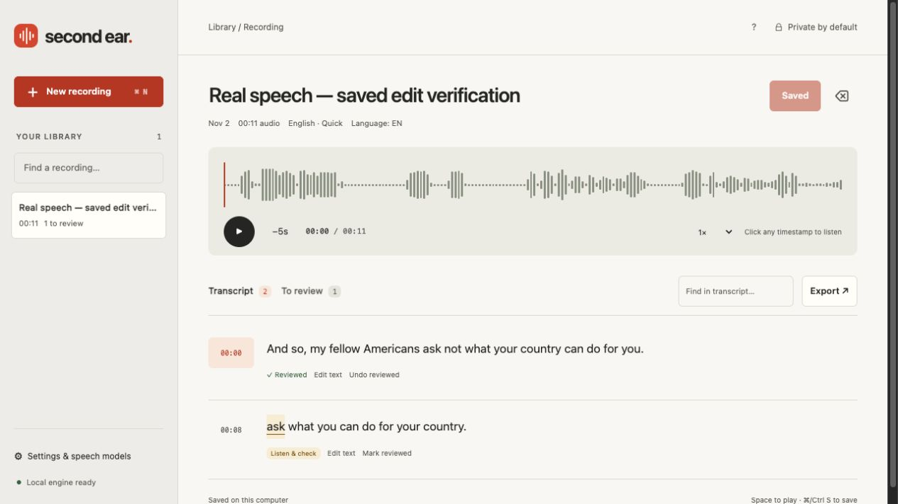

# Second Ear

Turn recordings into editable transcripts and subtitles on your own computer.
Import audio/video, transcribe locally, listen at any timestamp, review uncertain
passages, and export TXT, SRT, VTT or JSON. No account or transcription API key.



## Open the Mac app

Download the Apple Silicon Mac build from [Releases](https://github.com/maunguyengit/second-ear-studio/releases). Open the disk image, drag **Second Ear** to Applications, and open it. The ZIP is also available if preferred. The English Quick model is
included in that build. The editor opens in your browser at localhost; recordings
and processing stay on your Mac. The app has an ad-hoc signature; it is not Apple-notarized. Downloaded copies may need approval through the normal macOS security controls.

## Install from source (macOS / Linux)

Python 3.11–3.14 is required; Python 3.13 on Apple Silicon is the verified setup.

```bash
python3 -m venv .venv
source .venv/bin/activate
pip install .
second-ear
```

Or install the supplied wheel with `pip install /path/to/second_ear_studio-0.1.0-py3-none-any.whl`.
The source/wheel release downloads a speech model once when you choose it in
Settings. After setup, transcription works offline. The desktop build includes
its first model. Larger optional models require their own download.

## Use it

1. Drop a recording into **New recording**, or record from your microphone.
2. Choose the installed language/model, then **Transcribe**.
3. Click a timestamp to hear the source. Edit text, mark a passage reviewed, and
   **Save changes**. Uncertainty flags are model-based review hints, not calibrated
   accuracy estimates; errors can occur in unflagged text too.
4. Export a transcript or subtitles. Saved sessions survive closing the app.

MP3, M4A, WAV, FLAC, OGG, WebM and videos with an audio track are decoded by PyAV.
Limits: 250 MB per upload and two hours per recording. Actual codec availability
comes from the bundled FFmpeg/PyAV build. No system FFmpeg install is required.

## Privacy and operation

The single-user server binds only to `127.0.0.1`. It has no hosted mode, analytics,
external fonts or remote transcription. Model setup contacts Hugging Face only
when requested. A bundled public sample is clearly labeled; it is transcribed by
the same engine as your files. Closing the browser leaves the local app running;
choose **Settings → Quit Second Ear** to stop it.

The library is `~/Library/Application Support/Second Ear` on macOS and
`$XDG_DATA_HOME/second-ear` (or `~/.local/share/second-ear`) on Linux. To choose a
folder or run without opening a browser:

```bash
second-ear --data-dir /path/to/library --no-browser
```

Delete a session to remove its local original, playback and transcript. Back up
the entire library folder with the app stopped. Interrupted jobs can be retried;
retry replaces that incomplete transcript. Edits have revision checks so a second
window cannot silently overwrite a newer transcript. The app is not a network
service; do not expose it through a proxy or change its binding.

## Limits and verification

Automatic transcription can omit or invent words. Review the recording before
publishing. No speaker diarization, translation or system-wide dictation is
advertised in this release. English Quick is smaller and less accurate than the
larger multilingual choices. Edited text retains segment times; original word
alignment is not claimed for rewritten sentences.

See [release evidence](docs/verification.md) for actual tests, inference results,
platform checks and remaining limits. [Product research](docs/product.md) explains
the scope and comparison with existing apps. No breakthrough or market adoption
is claimed from building this release.

## Develop

```bash
pip install -e '.[test]'
pytest
```

Real-engine verification is separate: set `SECOND_EAR_TEST_MODEL_DIR` to a library
folder containing `models/tiny.en/`, then `pytest -m inference`. This path never
substitutes hardcoded transcripts. Keep private recordings and model caches out
of Git. See `docs/architecture.md` for the state/recovery contract.

## License

Original app code: MIT. Third-party libraries and speech models retain their own
licenses; see [THIRD-PARTY.md](THIRD-PARTY.md). No third-party application source
was copied into this implementation.
